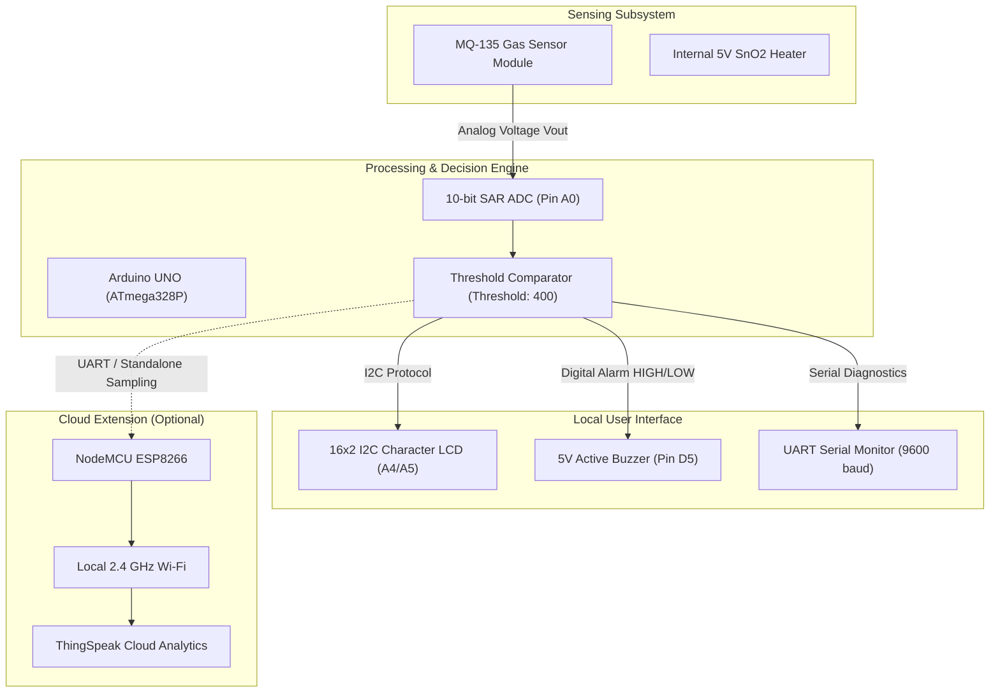

# 🍃 Air Quality Monitoring System

[](https://www.arduino.cc/)
[](#)
[](#)
[](https://thingspeak.com)
[](#)

A robust, low-power embedded environmental monitoring system that continuously measures air contamination levels using an **MQ-135** gas sensor, provides real-time numerical readings and safety indicators on an **I2C 16x2 LCD**, triggers an audible **buzzer alarm** when configurable thresholds are exceeded, and optionally streams telemetry data to the **ThingSpeak IoT Cloud** via **NodeMCU ESP8266**.

---

## 📝 Abstract

Exposure to hazardous airborne substances and poor indoor air quality directly affects human health, cognitive performance, and workplace safety. This project presents a practical embedded system engineered to monitor atmospheric gas presence in real-time. Built around an **Arduino UNO** and an **MQ-135** electrochemical tin dioxide ($\text{SnO}_2$) semiconductor sensor, the system reads continuous analog voltages reflecting gas concentration, displays formatted status metrics on a two-wire I2C LCD, and triggers an acoustic alarm whenever values breach safety thresholds. An optional **NodeMCU ESP8266** module bridges local telemetry to the cloud for historical analysis via ThingSpeak.

---

## ⚠️ Problem Statement

Hazardous gases like ammonia ($\text{NH}_3$), nitrogen oxides ($\text{NO}_x$), alcohol vapors, benzene, and smoke often accumulate invisibly in enclosed spaces, laboratories, factories, and domestic kitchens. Commercial certified environmental analyzers are bulky and costly, while typical hobbyist projects frequently misrepresent uncalibrated analog signals as certified scientific air quality index (AQI) values. There is a need for a reliable, transparent, low-cost monitoring solution with clear threshold alerting and responsible measurement reporting.

---

## 🎯 Project Objectives

1. **Continuous Sampling**: Measure relative gas concentrations using the MQ-135 sensor via 10-bit analog conversion.
2. **Visual Indication**: Render instantaneous values and status classifications (`NORMAL` vs `WARNING`) on an I2C 16x2 LCD with zero display flicker.
3. **Audible Hazard Warning**: Energize an acoustic buzzer when pollution breaches the user-configured threshold (`AIR_THRESHOLD = 400`).
4. **Cloud Telemetry (Optional IoT)**: Stream periodic data points to ThingSpeak using an ESP8266 Wi-Fi microcontroller.
5. **Responsible Engineering**: Strictly treat raw MQ-135 readings as relative electrical resistance indicators rather than certified laboratory PPM/AQI.

---

## ✨ Key Features

- ⚡ **Real-Time Responsiveness**: Fast loop execution with 500 ms sampling rate.
- 📺 **Zero-Flicker LCD Interface**: Fixed-coordinate screen updates with trailing character padding eliminate annoying full-screen refreshes.
- 🔔 **Autonomous Alarm Triggering**: Direct GPIO control of active buzzer alarm for instant audio notifications.
- ⚙️ **Configurable Thresholds**: Easily customize the warning baseline in firmware to suit specific ambient environments.
- 🌐 **Modular IoT Capability**: Dedicated, non-blocking firmware for NodeMCU ESP8266 with secure credential separation.
- 🛡️ **Fail-Safe Startup**: Initial display splash screen with warm-up stabilization delays for sensor heater priming.

---

## 🏗️ System Architecture



---

## 🔩 Hardware Components

| Component | Model / Description | Operating Voltage | Role in System |
| :--- | :--- | :---: | :--- |
| **Microcontroller** | Arduino UNO R3 (ATmega328P) | 5V DC | Primary controller, ADC sampling, display and alert logic |
| **Gas Sensor** | MQ-135 Air Quality Sensor Module | 5V DC ($\pm$ 0.1V) | Detects $\text{NH}_3$, $\text{NO}_x$, alcohol, benzene, smoke, $\text{CO}_2$ |
| **LCD Display** | 16x2 Alphanumeric Character LCD | 5V DC | Real-time text and numeric telemetry display |
| **I2C Backpack** | PCF8574 / PCF8574A I2C Adapter | 5V DC | Converts 16-pin LCD interface to 2-wire I2C bus (`0x27`/`0x3F`) |
| **Acoustic Alarm** | Active Piezoelectric Buzzer (5V) | 5V DC | Emits audible alarm tone upon threshold breach |
| **Prototyping** | Half/Full Breadboard & Dupont Wires | N/A | Solderless hardware interconnections |
| **Power Supply** | USB Type-B (5V, $\ge 500\text{ mA}$) | 5V DC | Powers Arduino, display, and high-current sensor heater |
| **IoT Module** *(Optional)* | NodeMCU ESP8266 (ESP-12E) | 3.3V / 5V (VIN) | Wireless telemetry transmitter to ThingSpeak cloud |

> Detailed hardware ratings and electrical datasheets are documented in [hardware/components.md](file:///c:/Users/kirub/OneDrive/Documents/air_quality_monitoring/hardware/components.md).

---

## 🔌 Circuit Connections & Pin Mapping

### Arduino UNO (Standard Setup)

| Module Pin | Arduino UNO Pin | Signal Type | Description |
| :--- | :--- | :--- | :--- |
| **MQ-135 VCC** | **5V** | Power | Powers internal heating element (~160 mA) |
| **MQ-135 GND** | **GND** | Ground | Common system ground reference |
| **MQ-135 AOUT** | **A0** | Analog Input | Output voltage proportional to gas presence (0 - 5V) |
| **LCD VCC** | **5V** | Power | Display controller and backlight supply |
| **LCD GND** | **GND** | Ground | Common ground |
| **LCD SDA** | **A4** | Bidirectional Data | I2C Serial Data |
| **LCD SCL** | **A5** | Clock Input | I2C Serial Clock |
| **Buzzer (+)** | **D5** | Digital Output | Alarm trigger (HIGH = Sound, LOW = Silent) |
| **Buzzer (-)** | **GND** | Ground | Common ground return |

> For complete wiring schematics and ESP8266 connection tables, refer to [hardware/pin-connections.md](file:///c:/Users/kirub/OneDrive/Documents/air_quality_monitoring/hardware/pin-connections.md) and [hardware/circuit-diagram.md](file:///c:/Users/kirub/OneDrive/Documents/air_quality_monitoring/hardware/circuit-diagram.md).

---

## 🔬 Working Principle

1. **Chemiresistive Gas Detection**:
   The sensor uses a Tin Dioxide ($\text{SnO}_2$) coating. When heated to operating temperature, atmospheric oxygen ions adsorb to the surface, creating an electron depletion barrier (high resistance $R_s$). Reducing gases react with adsorbed oxygen, returning electrons to the conduction band, lowering sensor resistance $R_s$.
2. **Voltage Divider & Conversion**:
   The change in resistance is converted into an analog voltage output ($V_{\text{out}}$) by an onboard load resistor ($R_L$).
3. **Digitization**:
   The Arduino UNO's 10-bit analog-to-digital converter reads pin `A0`, mapping $0 - 5\text{V}$ into discrete numerical values from $0$ to $1023$ ($\approx 4.887\text{ mV}$ per step).
4. **Classification & Actuation**:
   - If `sensorValue <= AIR_THRESHOLD`: Displays `Status: NORMAL`, buzzer remains `LOW`.
   - If `sensorValue > AIR_THRESHOLD`: Displays `Status: WARNING`, buzzer transitions to `HIGH`.

> Full electrochemical equations and circuit mathematics are available in [docs/working-principle.md](file:///c:/Users/kirub/OneDrive/Documents/air_quality_monitoring/docs/working-principle.md).

---

## 💻 Software Requirements & Libraries

- **Arduino IDE**: Version 1.8.x or 2.x
- **Core Libraries**:
  - `Wire.h` (Built into Arduino core)
  - `LiquidCrystal_I2C.h` (Install via Library Manager by *Frank de Brabander* or *Marco Schwartz*)
- **IoT Extension Libraries** (for NodeMCU only):
  - `ESP8266WiFi.h` (Included with ESP8266 board core)
  - `ThingSpeak.h` (Install via Library Manager by *MathWorks*)

---

## 🚀 Installation & Upload Guide

1. **Clone the Repository**:
   ```bash
   git clone https://github.com/kirubakar67-stack/Air-Quality-Monitoring.git
   ```
2. **Wire the Hardware**:
   Follow the wiring table above. Ensure all ground pins connect to a common reference.
3. **Open the Sketch**:
   Launch Arduino IDE and open [`arduino-uno/air_quality_monitor.ino`](file:///c:/Users/kirub/OneDrive/Documents/air_quality_monitoring/arduino-uno/air_quality_monitor.ino).
4. **Select Board & Port**:
   - **Tools** $\to$ **Board** $\to$ **Arduino Uno**
   - **Tools** $\to$ **Port** $\to$ Select active serial port (e.g., `COM3` on Windows)
5. **Compile & Upload**:
   Click **Verify** (`Ctrl+R`), then **Upload** (`Ctrl+U`).
6. **Open Serial Monitor**:
   Open **Serial Monitor** (`Ctrl+Shift+M`) at **9600 baud** to view real-time log statements.

---

## 🖥️ LCD Output & Display States

The 16x2 I2C LCD provides intuitive, non-flickering status updates:

### State 1: Startup & Initialization
```text
+----------------+
|Air Quality     |
|Initializing... |
+----------------+
```

### State 2: Clean Ambient Environment (Normal)
```text
+----------------+
|Sensor: 245     |
|Status: NORMAL  |
+----------------+
```
*Buzzer is silent; atmosphere is within safe baseline.*

### State 3: Contamination / Hazard Detected (Warning)
```text
+----------------+
|Sensor: 582     |
|Status: WARNING |
+----------------+
```
*Buzzer is energized continuously until air clears below threshold.*

---

## 🔔 Buzzer Alert Logic

The alert mechanism implements discrete hysteresis-ready threshold evaluation:

$$\text{Buzzer State} = \begin{cases} \text{HIGH (Alarm Active)}, & \text{if } \text{sensorValue} > \text{AIR\_THRESHOLD} \\ \text{LOW (Alarm Silent)}, & \text{if } \text{sensorValue} \le \text{AIR\_THRESHOLD} \end{cases}$$

- **Default Threshold**: Set to `400` in firmware.
- **Customizing Threshold**: Change the value in `air_quality_monitor.ino`:
  ```cpp
  const int AIR_THRESHOLD = 450; // Set to ~100-150 units above your clean-air baseline
  ```

---

## 🧪 Testing Procedure & Experimental Observations

1. **Sensor Pre-Heating**:
   Allow the MQ-135 to warm up for **2 to 3 minutes** after power-on. The heating element stabilizes the internal sensor temperature.
2. **Clean Air Baseline Observation**:
   In clean ambient air, observed ADC values typically stabilize between **200 and 320**.
3. **Controlled Gas Challenge**:
   Exposing the sensor to mild isopropyl vapor (or smoke from an extinguished match/incense) produces a rapid surge to **600+ ADC** within 2–3 seconds, triggering immediate buzzer activation and LCD state change.
4. **Clearing & Recovery**:
   Upon removing the gas source and circulating fresh air, the reading decays back below 400 within 15–30 seconds, automatically deactivating the alarm.

> Comprehensive testing protocols and troubleshooting matrices are found in [docs/testing.md](file:///c:/Users/kirub/OneDrive/Documents/air_quality_monitoring/docs/testing.md).

---

## 🌐 IoT Extension (ThingSpeak Integration)

For internet-connected environmental logging:
1. Navigate to the [`iot-version/`](file:///c:/Users/kirub/OneDrive/Documents/air_quality_monitoring/iot-version/) folder.
2. Copy `config.example.h` to `config.h`:
   ```bash
   cp iot-version/config.example.h iot-version/config.h
   ```
3. Enter your private 2.4 GHz Wi-Fi SSID, password, ThingSpeak Channel ID, and Write API Key.
4. Upload `iot-version/air_quality_iot.ino` to your NodeMCU ESP8266.
5. Telemetry feeds to ThingSpeak:
   - **Field 1**: Raw MQ-135 Sensor Reading
   - **Field 2**: Binary Alert Status (`0` for Normal, `1` for Warning)

---

## ⚠️ Engineering Limitations & Caveats

- **Relative Readings vs Certified AQI**: The MQ-135 produces relative analog values. It is **not** a certified laboratory gas chromatograph and should not be represented as calibrated scientific PPM or official government AQI without extensive controlled calibration chambers.
- **Broad Gas Cross-Sensitivity**: The sensor responds to multiple gases (ammonia, alcohol, butane, CO2, smoke) simultaneously and cannot isolate individual gas species.
- **Thermal & Humidity Dependence**: Ambient temperature and relative humidity affect baseline resistance ($R_0$).
- **Heater Power Demands**: High current draw (~160 mA) requires reliable 5V power rails.

---

## 💡 Applications

- 🏠 **Home & Kitchen Safety**: Detection of burnt cooking matter, solvent fumes, or smoldering insulation.
- 🏫 **Educational & Science Laboratories**: Demonstration of chemiresistors, I2C bus communications, and embedded thresholds.
- 🏢 **Office & Study Areas**: Monitoring stuffy indoor environments to prompt ventilation.
- 🛠️ **Electronics & Workshop Workspaces**: Warning against excessive soldering flux fumes and chemical solvent accumulation.

---

## 🔮 Future Enhancements

- [ ] **NDIR CO2 Sensor**: Integrate an optical NDIR sensor (e.g., MH-Z19C) for true, drift-free $\text{CO}_2$ ppm measurements.
- [ ] **Particulate Matter Detection**: Add a laser dust sensor (e.g., PMS5003 or SDS011) to track PM2.5 and PM10 particles.
- [ ] **Hysteresis Software Filter**: Implement dual-threshold software hysteresis to prevent rapid buzzer toggling near the threshold boundary.
- [ ] **OLED / TFT Interface**: Upgrade to a graphical color display showing historical trend curves directly on the device.

---

## 🛡️ Safety Precautions

1. **Burn Hazard**: The MQ-135 metallic cap and body become warm during operation due to the internal 5V heater. Avoid direct skin contact during extended operation.
2. **Flammable Gas Handling**: Never release raw combustible fuel or high-pressure gas directly onto the heated sensor mesh.
3. **Power Polarity**: Double-check 5V and GND connections before powering on to prevent damaging microcontroller GPIO pins.

---

## 📁 Repository Structure

```text
air-quality-monitoring/
├── README.md                           # Main project documentation and quickstart
├── .gitignore                          # Build artifacts and credential exclusion rules
├── arduino-uno/
│   ├── air_quality_monitor.ino         # Primary Arduino UNO production firmware
│   └── README.md                       # Arduino UNO specific upload and setup guide
├── iot-version/
│   ├── air_quality_iot.ino             # NodeMCU ESP8266 + ThingSpeak IoT firmware
│   ├── config.example.h                # Wi-Fi and ThingSpeak credentials template
│   └── README.md                       # IoT deployment and configuration instructions
├── hardware/
│   ├── components.md                   # Complete Bill of Materials and electrical specs
│   ├── pin-connections.md              # Point-to-point pin tables for UNO and ESP8266
│   └── circuit-diagram.md              # Mermaid schematics and ASCII circuit diagrams
└── docs/
    ├── working-principle.md            # Electrochemical sensing theory and math
    ├── testing.md                      # Testing protocols and troubleshooting matrix
    └── project-report.md               # Comprehensive engineering project report
```
