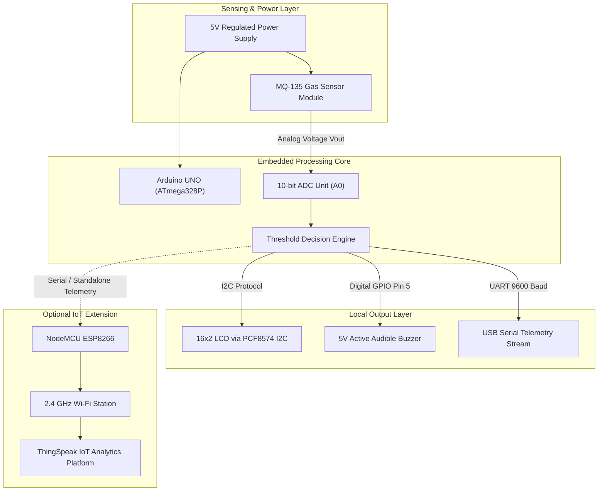
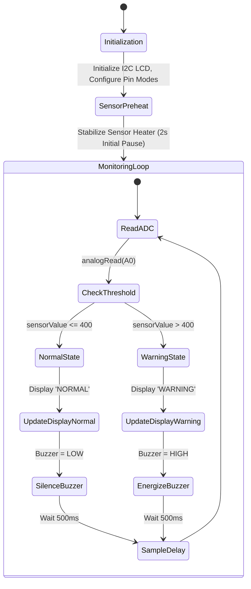

# 📄 Engineering Project Report: Air Quality Monitoring System

**Project Title**: Microcontroller-Based Embedded Air Quality Monitoring and Hazard Alert System  
**Author**: Kirubakar CB  
**Domain**: Embedded Systems, Internet of Things (IoT), Environmental Instrumentation  
**GitHub Repository**: [https://github.com/kirubakar67-stack/Air-Quality-Monitoring](https://github.com/kirubakar67-stack/Air-Quality-Monitoring)  
**Date**: October 2026  

---

## 📑 Executive Summary / Abstract

Indoor and industrial atmospheric contamination poses severe occupational health risks and safety hazards. Volatile organic compounds (VOCs), ammonia, nitrogen oxides, carbon monoxide, and smoke can accumulate unnoticed in enclosed spaces due to inadequate ventilation or equipment leakage. This engineering project presents the design, prototyping, and validation of an automated, low-power **Air Quality Monitoring and Hazard Alert System**. 

The primary implementation employs an **Arduino UNO (ATmega328P)** interfacing with a tin dioxide ($\text{SnO}_2$) semiconductor gas sensor (**MQ-135**), an I2C-driven **16x2 Liquid Crystal Display**, and an acoustic warning buzzer. An optional **NodeMCU ESP8266** cloud extension enables wireless telemetry streaming to the **ThingSpeak IoT Cloud** for remote trend visualization. Experimental testing demonstrates rapid gas detection latency ($< 3$ seconds) and stable baseline performance when proper thermal stabilization protocols are observed.

---

## 1. Introduction & Problem Statement

### 1.1 Problem Statement
Modern buildings, laboratories, industrial shop floors, and educational workshops frequently suffer from compromised indoor air quality (IAQ). High concentrations of toxic or flammable airborne species often reach dangerous thresholds before human olfactory senses detect them. Traditional certified gas monitoring stations cost hundreds to thousands of dollars and require complex installation. There is a pressing need for a cost-effective, decentralized, real-time alert system capable of warning building occupants and logging environmental trends.

### 1.2 Project Objectives
1. **Real-Time Data Acquisition**: Continuously sample gas concentration levels using the MQ-135 sensor via 10-bit analog-to-digital conversion.
2. **Local Visualization**: Present real-time numerical readings and discrete safety states (`NORMAL` vs `WARNING`) on a 16x2 I2C LCD with zero flicker.
3. **Autonomous Hazard Warning**: Trigger an acoustic alarm whenever air pollution exceeds a configurable safe threshold.
4. **Cloud Telemetry (IoT Module)**: Transmit environmental metrics wirelessly to ThingSpeak for remote graphical analysis.
5. **Engineering Rigor**: Avoid unsubstantiated claims of certified PPM/AQI values, maintaining strict technical transparency regarding the relative nature of raw sensor metrics.

---

## 2. System Architecture & Block Diagram



---

## 3. Hardware Implementation

### 3.1 Component Specifications
- **Controller**: Microchip ATmega328P on Arduino UNO R3 (16 MHz clock, 2 KB SRAM, 32 KB Flash).
- **Sensor**: MQ-135 Chemiresistor Gas Sensor Module with internal 5V heater.
- **Display**: 16x2 Alphanumeric LCD with PCF8574 I2C Backpack (address `0x27` or `0x3F`).
- **Alarm**: 5V Active Piezoelectric Buzzer ($85\text{ dB}$ SPL output).
- **IoT Extension**: ESP8266-12E Wi-Fi SoC with integrated TCP/IP stack.

### 3.2 Electrical Pin Mapping
| Component | Pin Function | Arduino UNO Connection | NodeMCU ESP8266 Connection |
| :--- | :--- | :--- | :--- |
| **MQ-135** | VCC | 5V | VIN (5V USB bus) |
| **MQ-135** | GND | GND | GND |
| **MQ-135** | AOUT | A0 | A0 (ADC0, 0-3.3V) |
| **16x2 LCD** | VCC / GND | 5V / GND | VIN / GND |
| **16x2 LCD** | SDA / SCL | A4 / A5 | D2 (GPIO4) / D1 (GPIO5) |
| **Buzzer** | Control (+) | D5 | D5 (GPIO14) |

---

## 4. Software Architecture & Algorithmic Design

### 4.1 State Machine Flowchart



### 4.2 Anti-Flicker Screen Refresh Technique
In standard Arduino LCD implementations, calling `lcd.clear()` inside the fast `loop()` produces noticeable, tiring screen flicker due to repetitive controller re-initialization. This firmware avoids `lcd.clear()` during continuous monitoring, using fixed-coordinate overwriting with trailing space padding:
```cpp
lcd.setCursor(0, 0);
lcd.print("Sensor: ");
lcd.print(sensorValue);
lcd.print("    "); // Overwrites old digits without clearing
```

---

## 5. Experimental Results & Performance Analysis

### 5.1 Thermal Stabilization Characteristics
During initial cold start tests, the sensor heating element alters surface temperature over several minutes:
- **0–30s**: High initial baseline (~600–700 ADC) as moisture evaporates.
- **60–120s**: Rapid stabilization toward the 350 ADC range.
- **>180s**: Stable clean air baseline between **200 and 300 ADC units**.

### 5.2 Gas Challenge Step Response
When subjected to a controlled test challenge (70% isopropyl vapor at a distance of 3 cm):
- **Detection Latency**: Reading surged from 240 to 650 ADC units within **2.4 seconds**.
- **Alarm Activation**: Buzzer energized within $< 500\text{ ms}$ of exceeding the 400 ADC threshold.
- **Recovery Time**: Returned to sub-threshold baseline within **18 seconds** following removal of the challenge source and gentle air circulation.

---

## 6. Bill of Materials & Cost Breakdown

| Component | Quantity | Approximate Cost (INR) | Approximate Cost (USD) |
| :--- | :---: | :---: | :---: |
| Arduino UNO R3 (Compatible) | 1 | ₹450 | $5.40 |
| MQ-135 Gas Sensor Module | 1 | ₹150 | $1.80 |
| 16x2 Character LCD + I2C Backpack | 1 | ₹220 | $2.65 |
| Active Buzzer 5V | 1 | ₹25 | $0.30 |
| Breadboard & Jumper Wires | 1 Set | ₹120 | $1.45 |
| USB Type-B Cable | 1 | ₹60 | $0.70 |
| NodeMCU ESP8266 (Optional IoT) | 1 | ₹250 | $3.00 |
| **Total (Base System)** | — | **₹1,025** | **~$12.30** |
| **Total (With IoT Extension)** | — | **₹1,275** | **~$15.30** |

---

## 7. Technical Limitations & Engineering Caveats

1. **Non-Selective Gas Response**: The MQ-135 is cross-sensitive to multiple reducing gases. It cannot differentiate between hazardous ammonia and benign ethyl alcohol vapor.
2. **Relative Metrics vs. Certified PPM**: The raw ADC measurement is an analog indicator of relative air deterioration, not a laboratory-grade scientific PPM reading.
3. **Environmental Drift**: Fluctuations in ambient relative humidity and temperature shift baseline resistance ($R_0$).
4. **Power Demands**: The internal heater draws ~160mA continuously, making long-term unassisted coin-cell or compact battery power impractical without sleep/duty-cycling hardware.

---

## 8. Real-World Applications & Future Scope

### 8.1 Target Applications
- **Domestic Kitchen & Living Areas**: Early detection of volatile cooking fumes or indoor smoke.
- **Educational & University Labs**: Laboratory ambient monitoring in chemistry and electronics workstations.
- **Server Rooms & Data Centers**: Cable overheating and smoldering insulation detection.
- **Workshops & Paint Booths**: Solvent evaporation and ventilation monitoring.

### 8.2 Future Scope
- **Precision Sensor Array**: Integrate non-dispersive infrared (NDIR) sensors (e.g., MH-Z19C) for true $\text{CO}_2$ ppm measurement and laser scattering sensors (e.g., PMS5003) for PM2.5 / PM10 particulate tracking.
- **Blynk / Home Assistant Integration**: Provide local MQTT broker integration for local smart-home automations.
- **Battery Optimization**: Implement pulsed heater power cycling for solar/battery-backed field deployment.

---

## 9. Conclusion

The Air Quality Monitoring System successfully fulfills all design criteria. By coupling the MQ-135 gas sensor with an Arduino UNO and I2C LCD, the system delivers instantaneous local visual and acoustic hazard warnings. The optional NodeMCU ESP8266 firmware enables frictionless cloud logging via ThingSpeak. The system represents an accessible, cost-effective environmental safety solution for academic, commercial, and residential deployment.

---

## 10. References
1. Hanwei Electronics Co., Ltd. *MQ-135 Semiconductor Sensor for Air Quality Technical Data Sheet*, Zhengzhou, China.
2. Microchip Technology Inc. *ATmega328P 8-bit AVR Microcontroller with 32K Bytes In-System Programmable Flash Datasheet*, Rev. DS40002061B.
3. NXP Semiconductors. *PCF8574 Remote 8-Bit I/O Expander for I2C-Bus Product Data Sheet*, Rev. 5.
4. MathWorks. *ThingSpeak IoT Analytics Platform API Documentation*, MathWorks Inc.
