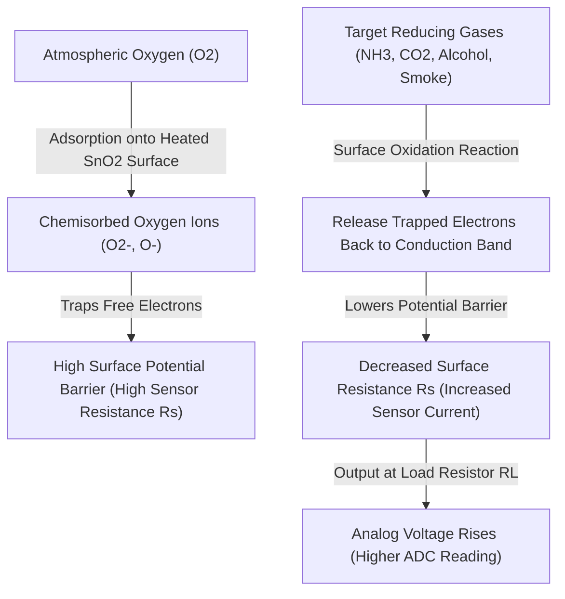
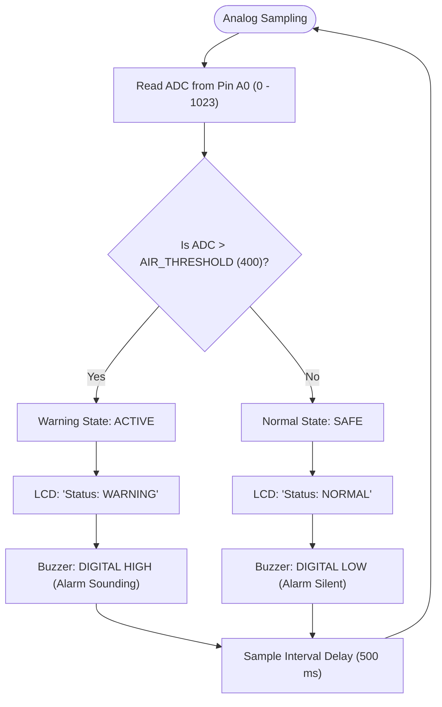

# 🔬 Working Principle & Theoretical Analysis

This document details the underlying physical, electrochemical, and computational principles governing the **Air Quality Monitoring System**.

---

## 1. Electrochemical Sensing Mechanism ($\text{SnO}_2$)

The **MQ-135** sensor operates on the principle of **chemiresistive semiconductor gas detection**.

### Chemical Kinetics on the Sensor Surface
1. **In Clean Ambient Air**:
   - The integrated micro-heater raises the temperature of the Tin Dioxide ($\text{SnO}_2$) sensing crystal layer to its optimal catalytic operating temperature ($\sim 200^\circ\text{C} - 300^\circ\text{C}$).
   - Atmospheric oxygen adsorbs onto the surface of the polycrystalline $\text{SnO}_2$ grains, capturing electrons from the crystal's conduction band:
     $$\text{O}_{2\text{ (gas)}} + 2e^- \longrightarrow 2\text{O}^-_{\text{ (ads)}}$$
   - This creates an electron depletion layer near the grain boundaries, resulting in a **high surface potential barrier** and relatively **high internal electrical resistance ($R_s$)**.

2. **In the Presence of Reducing Gases**:
   - When reducing or oxidizable gases (such as Ammonia $\text{NH}_3$, Carbon Monoxide $\text{CO}$, ethanol vapor, or smoke hydrocarbons) encounter the heated surface, they undergo catalytic oxidation with the adsorbed oxygen ions:
     $$\text{CO} + \text{O}^-_{\text{ (ads)}} \longrightarrow \text{CO}_2 + e^-$$
   - The reaction transfers previously trapped electrons back into the $\text{SnO}_2$ conduction band.
   - The electron depletion barrier thins, the grain boundary barrier height drops, and the sensor's bulk resistance **$R_s$ drops significantly**.

---

## 2. Analog Signal Conditioning & Voltage Conversion

The internal module circuit forms a **voltage divider** between the variable sensor resistance ($R_s$) and an onboard reference load resistor ($R_L$):

$$V_{\text{out}} = V_{\text{CC}} \times \left( \frac{R_L}{R_s + R_L} \right)$$

Where:
- $V_{\text{CC}} = 5.0\text{ V DC}$
- $R_s = \text{Variable sensor surface resistance}$
- $R_L = \text{Load resistance (typically } 10\text{ k}\Omega \text{ to } 47\text{ k}\Omega\text{)}$

As hazardous gas concentration **increases**, $R_s$ **decreases**, causing the output voltage $V_{\text{out}}$ to **rise toward $5\text{V}$**.

---

## 3. Microcontroller Analog-to-Digital Conversion (ADC)

The Arduino UNO’s ATmega328P digitizes the analog voltage using an internal **10-bit Successive Approximation Register (SAR) ADC**:

$$\text{ADC Value} = \text{round}\left( \frac{V_{\text{in}}}{V_{\text{ref}}} \times 1023 \right)$$

With $V_{\text{ref}} = 5.0\text{ V}$, each discrete digital step corresponds to:

$$\text{Resolution} = \frac{5.0\text{ V}}{1023} \approx 4.887\text{ mV per LSB}$$

### Threshold Decision Logic

---

## 4. I2C Bus Communication Protocol

Communication with the 16x2 character display is mediated via the **Philips/NXP I2C protocol** using only two bidirectional lines:

- **SDA (Serial Data Line)**: Transmits byte commands and character ASCII data.
- **SCL (Serial Clock Line)**: Synchronizes data transfers at standard 100 kHz clock frequency.

The **PCF8574** expander accepts 8-bit serial I2C frames and outputs parallel control lines to the HD44780 LCD controller in 4-bit nibble mode:
- 4 Data bits ($D_4 - D_7$)
- Register Select ($RS$)
- Read/Write ($RW$)
- Enable strobe ($EN$)
- Backlight LED control transistor

---

## 5. Sensor Calibration Realities: Relative vs. Certified Values

> [!IMPORTANT]
> **Engineering Transparency Notice**:
> Many hobbyist projects incorrectly claim that the MQ-135 provides accurate "ppm of $\text{CO}_2$" or official "Air Quality Index (AQI)" values directly through simple mathematical transformations. In embedded engineering practice:
> 1. **Cross-Sensitivity**: The MQ-135 is sensitive to multiple gases simultaneously ($\text{NH}_3$, ethanol, benzene, $\text{CO}_2$, smoke). It cannot distinguish between 50 ppm alcohol vapor and 1000 ppm $\text{CO}_2$ on a single channel without a chromatographic column or spectroscopic filter.
> 2. **Ambient Humidity and Temperature Dependence**: The surface adsorption equilibrium varies with ambient relative humidity and room temperature.
> 3. **Baseline Drift ($R_0$)**: $R_0$ (the baseline resistance in clean air) drifts over the lifespan of the heating element and requires calibration against a certified standard.
>
> Therefore, this project operates scientifically as a **Relative Threshold Air Quality Indicator**, identifying relative air deterioration and alert levels safely.
