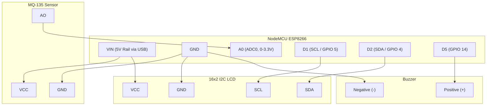

# ⚡ Circuit Schematic & Wiring Architecture

This document presents the electronic circuit architecture, signal routing diagrams, and power distribution schematics for the **Air Quality Monitoring System**.

---

## 📐 Arduino UNO System Wiring Diagram

```mermaid
graph TD
    subgraph Power["Power Supply (5V USB / External)"]
        VCC5V["+5V DC Power Rail"]
        GND["System Ground (GND)"]
    end

    subgraph MCU["Arduino UNO (ATmega328P)"]
        PIN_5V["5V Pin"]
        PIN_GND["GND Pin"]
        PIN_A0["Analog Pin A0"]
        PIN_A4["I2C SDA (A4)"]
        PIN_A5["I2C SCL (A5)"]
        PIN_D5["Digital Pin D5"]
    end

    subgraph Sensor["MQ-135 Gas Sensor Module"]
        MQ_VCC["VCC"]
        MQ_GND["GND"]
        MQ_AO["Analog Out (AO)"]
        MQ_HEATER["Internal SnO2 Heater"]
    end

    subgraph Display["16x2 I2C LCD (PCF8574 Backpack)"]
        LCD_VCC["VCC"]
        LCD_GND["GND"]
        LCD_SDA["SDA"]
        LCD_SCL["SCL"]
    end

    subgraph Alert["Active 5V Buzzer"]
        BUZZ_POS["Positive (+)"]
        BUZZ_NEG["Negative (-)"]
    end

    %% Power Routing
    PIN_5V --> VCC5V
    PIN_GND --> GND
    VCC5V --> MQ_VCC
    VCC5V --> LCD_VCC
    GND --> MQ_GND
    GND --> LCD_GND
    GND --> BUZZ_NEG

    %% Signal Lines
    MQ_AO -->|Analog Voltage (0-5V)| PIN_A0
    PIN_A4 -->|I2C Data Bus| LCD_SDA
    PIN_A5 -->|I2C Clock Bus| LCD_SCL
    PIN_D5 -->|Digital Alarm Trigger (HIGH/LOW)| BUZZ_POS
```

---

## 🔌 ASCII Circuit Schematic (Arduino UNO)

```text
              +---------------------------------------------+
              |                Arduino UNO                  |
              |                                             |
              |   [5V]  [GND]   [A0]    [A4]   [A5]   [D5]  |
              +----+------+-------+------+------+------+----+
                   |      |       |      |      |      |
                   |      |       |      |      |      |
   +---------------+      |       |      |      |      |
   |   +------------------+       |      |      |      |
   |   |                          |      |      |      |
+--+---+--------+                 |      |      |      |
|  VCC GND  AO  |                 |      |      |      |
|    MQ-135     |--------(AO)-----+      |      |      |
|  Gas Sensor   |                               |      |
+---------------+                               |      |
                                                |      |
   +--------------------------------------------+      |
   |   +-----------------------------------------------+
   |   |                                               |
+--+---+--------+                                      |
|  SDA SCL  VCC |                                      |
| 16x2 I2C LCD  |                                      |
|   Backpack    |                                      |
|      GND      |                                      |
+-------+-------+                                      |
        |                                              |
        +---------------+                              |
                        |                              |
+-----------------------+                              |
|                       |                              |
|  Active Buzzer        |                              |
|   (-)           (+)   |                              |
+----+-------------+----+                              |
     |             |                                   |
     +--- GND      +-----------------(D5)--------------+
```

---

## 🌐 NodeMCU ESP8266 IoT Circuit Schematic



---

## 🛠️ Breadboard Wiring Best Practices

1. **Power Rails**:
   - Dedicate the top red rail for `+5V` and the blue rail for `GND`.
   - Ensure a single jumper connects Arduino `5V` and `GND` to these rails.
2. **Noise Decoupling**:
   - The MQ-135 heating element creates slight resistive heating fluctuations. Placing a 100nF ceramic capacitor across the sensor power pins close to the module helps stabilize analog reference levels.
3. **Contrast Adjustment**:
   - If the LCD powers on with solid blue boxes or blank characters, adjust the blue potentiometer on the back of the I2C backpack with a small screwdriver until character outlines are sharp and readable.
