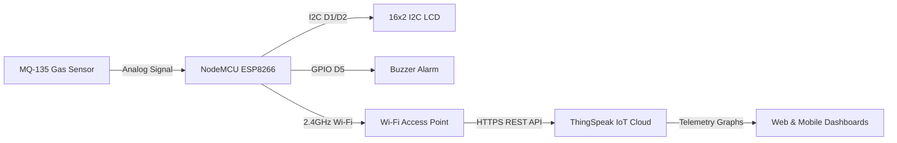

# 🌐 IoT Version: NodeMCU ESP8266 & ThingSpeak Integration

This directory contains the IoT cloud-connected firmware for the **NodeMCU ESP8266** module, extending the local air quality monitor to stream real-time telemetry to the **ThingSpeak** cloud dashboard.

---

## 🎯 Architecture Overview



---

## 🔌 Hardware Connections (NodeMCU V2/V3)

| Component Pin | NodeMCU Pin | Function / Description |
| :--- | :--- | :--- |
| **MQ-135 VCC** | **VIN (5V)** | Connect to 5V rail; internal heater requires 5V $\pm$ 0.1V |
| **MQ-135 GND** | **GND** | Common ground reference |
| **MQ-135 AOUT** | **A0 (ADC0)** | Analog output (0 - 3.3V maximum rating) |
| **LCD VCC** | **VIN (5V)** | 5V supply for PCF8574 I2C backpack |
| **LCD GND** | **GND** | Common ground reference |
| **LCD SDA** | **D2 (GPIO 4)** | I2C Serial Data line |
| **LCD SCL** | **D1 (GPIO 5)** | I2C Serial Clock line |
| **Buzzer (+)** | **D5 (GPIO 14)** | Digital output control line |
| **Buzzer (-)** | **GND** | Ground reference |

> [!WARNING]
> **ADC Voltage Compatibility**:
> The NodeMCU board's `A0` pin tolerates an absolute maximum of **3.3V** (due to an onboard 220k/100k voltage divider reducing it to 1.0V for the raw ESP8266 silicon). Because the MQ-135 module is powered by 5V, severe gas saturation can cause output voltages greater than 3.3V. For production environments, insert a 1.8k $\Omega$ / 3.3k $\Omega$ resistive voltage divider between MQ-135 AOUT and NodeMCU A0 to guarantee overvoltage protection.

---

## 🔒 Secure Credential Setup

To protect your private network credentials and API keys from leaking to public Git repositories:

1. Copy the template file:
   ```bash
   cp config.example.h config.h
   ```
2. Open `config.h` in an editor and enter your actual Wi-Fi SSID, password, and ThingSpeak details:
   ```cpp
   const char* WIFI_SSID = "MyHomeWiFi";
   const char* WIFI_PASS = "SecretPassword123";

   const unsigned long THINGSPEAK_CHANNEL_ID = 1234567;
   const char* THINGSPEAK_WRITE_API_KEY      = "ABCD1234EFGH5678";
   ```
3. `config.h` is explicitly excluded in `.gitignore` and will never be tracked or pushed to GitHub.

---

## 📊 ThingSpeak Channel Configuration

1. Create a free account at [ThingSpeak.com](https://thingspeak.com).
2. Click **Channels** $\to$ **New Channel**.
3. Configure the fields as follows:
   - **Name**: `Air Quality Monitoring System`
   - **Field 1**: `MQ-135 Raw ADC Reading`
   - **Field 2**: `Alarm Trigger Status (0: Normal, 1: Warning)`
4. Save the channel.
5. Go to the **API Keys** tab and copy your numeric **Channel ID** and 16-character **Write API Key**.

---

## 📦 Required Libraries

Install the following libraries via **Arduino IDE Library Manager**:
1. **`ThingSpeak`** (by MathWorks)
2. **`LiquidCrystal_I2C`** (by Frank de Brabander)
3. **ESP8266 Board Package**:
   - In Arduino IDE, open **Preferences**.
   - Add this Additional Boards Manager URL:
     `http://arduino.esp8266.com/stable/package_esp8266com_index.json`
   - Go to **Boards Manager**, search for `esp8266`, and install version 3.x.

---

## 🚀 Flashing the ESP8266

1. In Arduino IDE, select **Tools** $\to$ **Board** $\to$ **ESP8266 Boards** $\to$ **NodeMCU 1.0 (ESP-12E Module)**.
2. Select **Upload Speed**: `115200`.
3. Select your NodeMCU COM port.
4. Click **Upload**.
5. Open the **Serial Monitor** at **115200 baud** to verify Wi-Fi association and periodic HTTP 200 responses from ThingSpeak.
